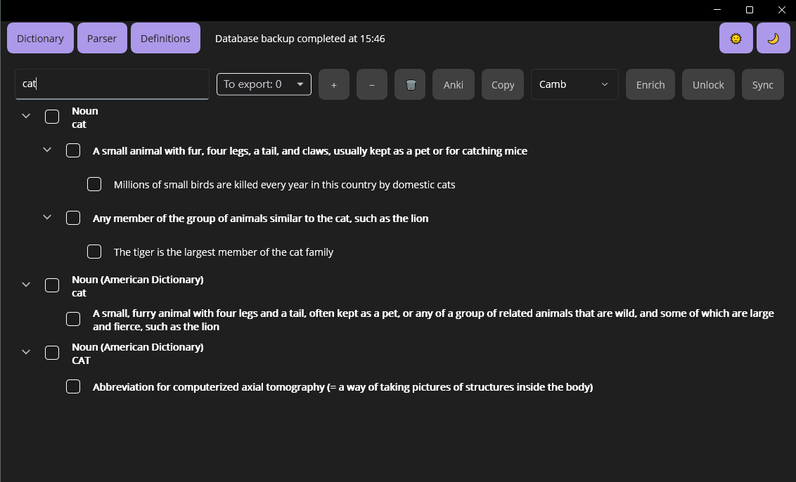
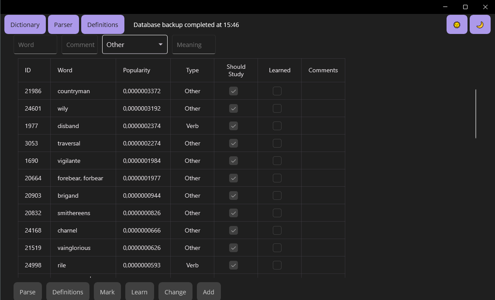

# SmartBox

SmartBox is a Windows desktop app for building a personal English vocabulary. It collects meanings and examples for a word from the Cambridge Dictionary and OpenAI, stores words in PostgreSQL and exports flashcards to Anki.

Built with .NET 9 and .NET MAUI.





## Features

- **Parser.** Enter a word, or the ID of a saved word, and get its meanings and examples. The source is picked per request:
  - Cambridge only;
  - Cambridge plus AI for the entered words and the forms Cambridge finds;
  - Cambridge plus AI for the entered words only;
  - AI only.

  In the modes with AI, it also adds examples to Cambridge meanings that have too few.
- **Dictionary.** Search saved words by spelling or by meaning, add words, mark them to study or as learned, change the part of speech. Each new word gets a popularity score from Google Books Ngram data, and the words to study are ordered by it.
- **Sync.** Edit a saved word's meanings and examples in the Parser and write them back to the database.
- **Export.** Collect words into an export list and save it as an Anki TSV file, or copy it to the clipboard in the same format.
- **Backups.** The app dumps the database with `pg_dump` once a day and keeps the latest 30 dumps. Backup status is shown in the title bar.
- Light and dark themes.

## Tech stack

| Area | Tools |
| --- | --- |
| UI | .NET MAUI (Windows), CommunityToolkit.Mvvm, CommunityToolkit.Maui, Syncfusion DataGrid and TreeView |
| Data | PostgreSQL, EF Core 9 with Npgsql |
| AI | OpenAI .NET SDK, structured output with JSON Schema |
| Parsing | AngleSharp |
| Resilience and logging | Polly, Serilog |
| Tests | xUnit, Testcontainers for PostgreSQL |

## Architecture

The solution follows Clean Architecture: dependencies point inward, and each layer registers its own services.

| Project | Role |
| --- | --- |
| `Domain` | Models and rules for words, definitions and examples. Interfaces for storage and external services. |
| `Application` | Use cases: adding and learning words, building meanings from Cambridge and AI, the backup schedule. |
| `Infrastructure` | EF Core repository, Cambridge Dictionary parser, OpenAI client, Google Ngram client, Anki export, `pg_dump` backups. |
| `SmartBox` | The MAUI app: pages, view models, dependency injection setup. |
| `Shared` | The mapper interface and string helpers. |

Each of the four main projects has its own test project.

## Getting started

You need Windows 10 version 1809 or later, the .NET 9 SDK with the MAUI workload, and a PostgreSQL database.

1. Set the environment variables:

   | Variable | Value |
   | --- | --- |
   | `OPENAI_API_KEY` | Your OpenAI API key. |
   | `ENGLISH_WORDS_STORAGE` | The PostgreSQL connection string. |
   | `PG_DUMP_PATH` | Optional. The full path to `pg_dump.exe`. Without it, the app looks in `Program Files\PostgreSQL\<version>\bin` and then in `PATH`. |

2. Create the tables `englishwords`, `definitions` and `examples`. The schema is defined in `Infrastructure/MyDbContext.cs`; the project has no migrations.
3. Open `SmartBox.sln` in Visual Studio 2022 and run the `SmartBox` project on Windows Machine.

On first start, the app copies `config.json` to `Documents\SmartBox`. Edit that copy to change the OpenAI model, the number of AI examples, the Cambridge timeout, the backup interval and the window size. Logs go to `Documents\SmartBox\Logs` and backups to `Documents\SmartBox\Backups`.

## Tests

```bash
dotnet test
```

Integration tests start PostgreSQL 15 in Docker through Testcontainers, so Docker must be running. Parser tests run against saved Cambridge Dictionary pages in `Infrastructure.Tests/TestData`.
